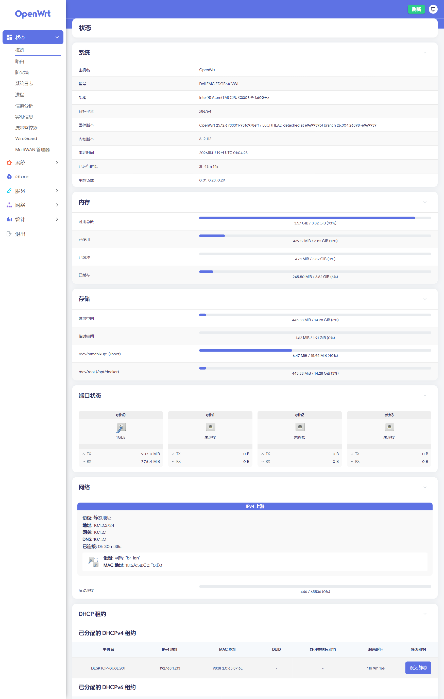
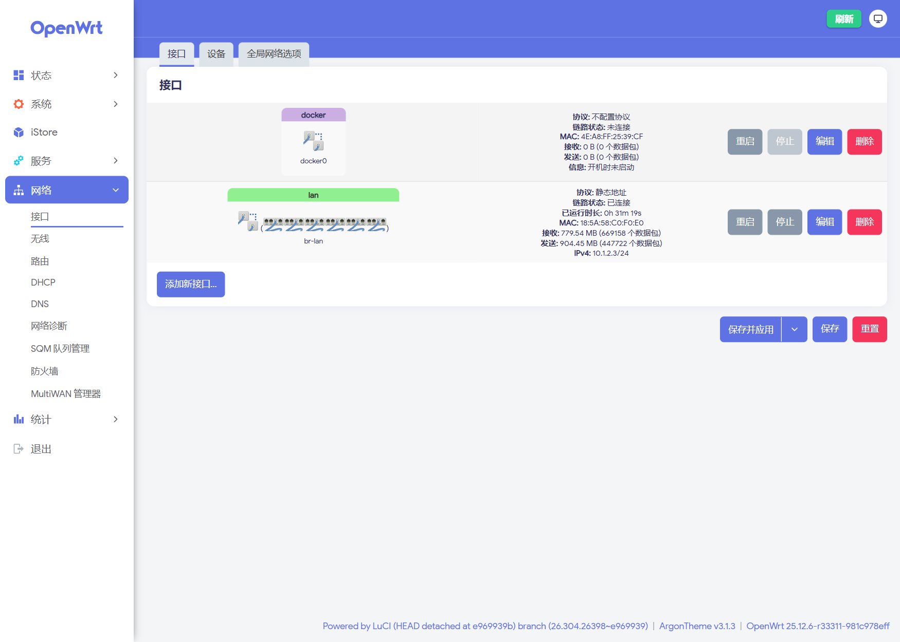
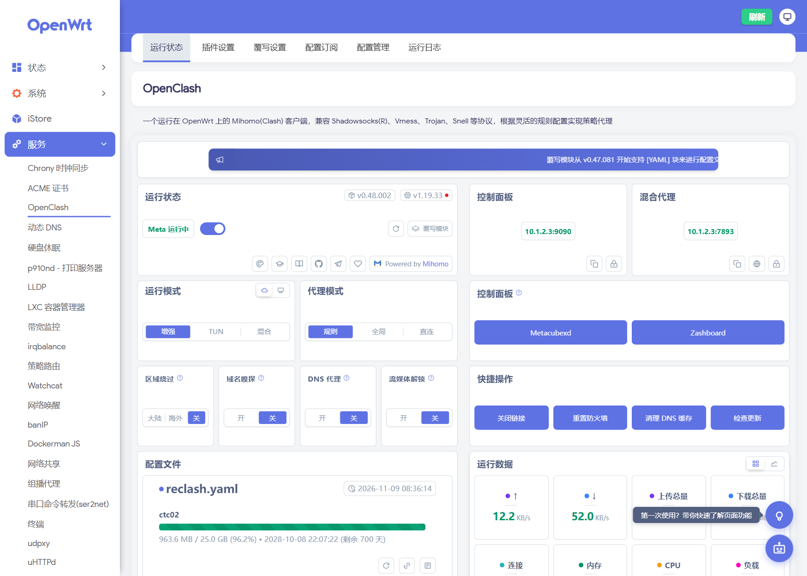
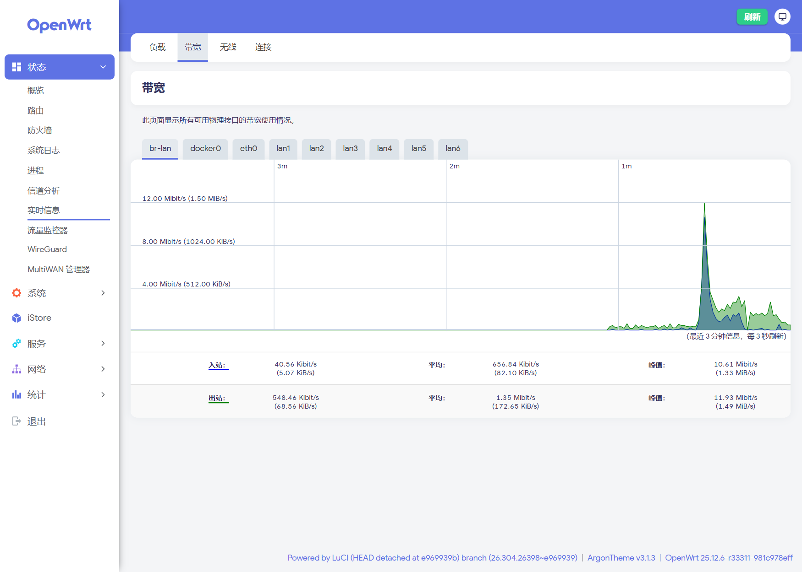
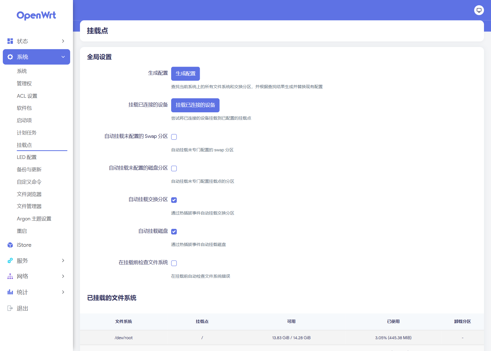
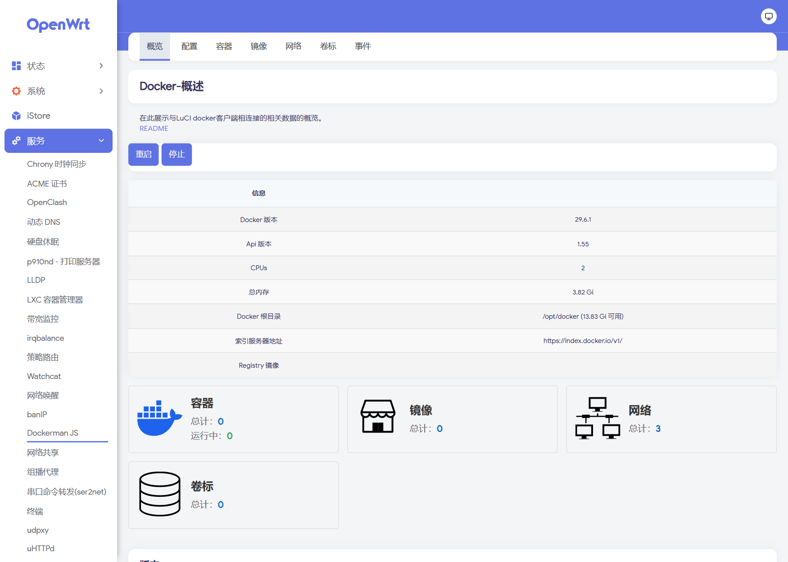

# Edge 610 OpenWrt Firmware Build

[简体中文](README.md) | **English**

A full-source OpenWrt image for the **VMware SD-WAN Edge 610** (same hardware as the Dell EMC VEP1400), built by GitHub Actions.

- Target: Intel Atom **C3308** (2C/2T 1.6 GHz, no AVX/AVX2) / 4 GB DDR4 / 16 GB eMMC (`/dev/mmcblk0`, 14.6 GiB usable) / no video output (Micro-USB serial console, 115200 8N1)
- Network: 2× **1G SFP** (native X553, `ixgbe`) + 6× **1G RJ45** (on-board Marvell 88E6190, DSA `lan1..lan6`) — every port is capped at 1G, see [Port speed limits](#port-speed-limits)
- Watchdog: on-board PIC hardware WDT (iSMT SMBus `0x22/0x24`); the boot script clears it, otherwise the box reboots after 4–5 minutes

## Screenshots

| Status overview | Network interfaces |
| --- | --- |
|  |  |

| OpenClash | Realtime traffic |
| --- | --- |
|  |  |

| Mount points (rootfs already grown) | Docker |
| --- | --- |
|  |  |

> Captured on real hardware: Argon v3 theme, Chinese UI. The box in the screenshots uses `10.1.2.3/24`; the image defaults to `192.168.1.1/24`.

## Hardware (measured)

| Item | Value |
| --- | --- |
| CPU | `Intel(R) Atom(TM) CPU C3308 @ 1.60GHz` (2C/2T, no AVX/AVX2) |
| RAM | 4,003,672 kB ≈ 3.8 GiB |
| eMMC | `mmc0:0001 AJTD4R` 14.6 GiB (`/dev/mmcblk0`; HS400, ~293 MB/s sequential read). Image layout: p1 16M vfat `/boot`, p2 rootfs, p128 239K BIOS boot |
| NIC | 4× `8086:15c3` X553 Backplane (BIOS reports chip type **X550**) |
| Port mapping | `eth0` = `03:00.0` = switch CPU link (**CPU port 10**, conduit); `eth1` = `03:00.1` unused; `eth2` = `05:00.0`, `eth3` = `05:00.1` = the two SFP ports |
| SFP speed | **1G only** (no 2.5G, no 10G). Dell spec: Edge 610 = `2×1G SFP`, only 620/640/680 get `2×10G SFP+`. All four X553 functions are `8086:15c3` = `X550EM_A_KR_L` (1G backplane variant) and the driver returns 1G for that device ID. Forcing 2.5GBASE-X (`x553_speed=2500` + switch `MAC_CTL=0x303f`) still links at 1G |
| WiFi | `168c:003c` QCA986x/988x (ath10k + `ath10k-firmware-qca988x`) |

> Why not ImageBuilder: the official x86 prebuilt kernel has `CONFIG_NET_DSA` / `MV88E6XXX` disabled, ships no `i2c-ismt`, and cannot compile the out-of-tree modules this board needs. This repo therefore builds OpenWrt 25.12.6 from source.

## Port speed limits

| Interface | Limit | Basis |
| --- | --- | --- |
| 6× RJ45 `lan1..lan6` | **1G per port** | Marvell 88E6190 is a gigabit switch |
| 2× SFP | **1G** | Dell spec: Edge 610 = `2×1G SFP`; X553 is `8086:15c3` (KR_L, 1G backplane) |
| Internal CPU link (switch ↔ X553) | **1G** | Hardware can be set to 2.5GBASE-X, but forcing it still links at 1G |

- **No 2.5G**: the SFP driver capability table only has 1G/10G; the CPU link does not come up at 2.5G in practice (`x553_speed=2500` + `MAC_CTL=0x303f` still 1G).
- **No 10G**: 10G SFP+ exists only on Edge 620/640/680 (4/8/16 cores); the 610's X553 is strapped as KR_L (1G).
- Want 2.5G/10G? Use a 620 or above, or add a USB 2.5G NIC (the image already ships `kmod-usb-net-rtl8152`).

## Build artifacts

After a successful Actions run, download the `Edge610-OpenWrt-Image` artifact (zip):

| File | Description |
| --- | --- |
| `openwrt-x86-64-generic-ext4-combined-efi.img.gz` | **Flashable image** (EFI, 1024 MB rootfs, build-system default name) |
| `edge610-YYYYMMDD-HHMM.img.gz` | Same image with a **timestamped name** (GMT+8; produced by CI and local builds) |
| `openwrt-x86-64.manifest` | Installed package list |
| `sha256sums` | Checksums |

## Building

1. Actions → **Build Edge 610 OpenWrt Image** → *Run workflow* (main branch).
2. About 3.5–4 hours on a 4-core runner (full source build + toolchain). On failure a `build-log` artifact (`build.log` / `dl.log`) is uploaded automatically.

### Local build (recommended for iteration)

CI uses a fresh runner every time and must rebuild rustc + the toolchain (~70% of the time). A local VM keeps the cache: **~75 minutes for the first run, typically 3–10 minutes for later package changes**.

```bash
# Requirements: Ubuntu 24.04 x86_64, >=8 cores, >=16 GB RAM, >=60 GB free disk (ext4)
PROXY=http://192.168.68.1:7897 ./scripts/build-local.sh
```

- `PROXY` is optional: set it when GitHub / OpenWrt mirrors are flaky on your network.
- The script mirrors CI exactly (same feeds pin, same `.config` seed, same ixgbe autoload strip, same final checks) and is idempotent.
- Output: `~/work/openwrt/bin/targets/x86/64/openwrt-x86-64-generic-ext4-combined-efi.img.gz`
- Download resilience is built in: `CURL_OPTIONS` with a 600 s per-file cap and a 60 s low-speed abort, retried 3 times.

## Image contents

| Component | Version / notes |
| --- | --- |
| OpenWrt | 25.12.6 (x86_64, kernel 6.12.112) |
| LuCI | official feed |
| OpenClash | 0.48.002 (official stable release tag) |
| Mihomo core | v1.19.33 `linux-amd64-v1` (**no AVX2**, preinstalled at `/etc/openclash/core/clash_meta`) |
| DNS | `dnsmasq-full` (replaces the default dnsmasq) |
| Switching | `kmod-dsa` + `kmod-dsa-mv88e6xxx` + this repo's `edge610_dsa` (ports named `lan1..lan6`) |
| NIC driver | `kmod-ixgbe` (**autoload stripped**, loaded in order by the init script) |
| Watchdog bus | `kmod-i2c-ismt` + `i2c-tools` |
| Temperature | `kmod-hwmon-coretemp` + `lm-sensors` (Denverton via MSR; `/sys/class/thermal` has zones) |
| WiFi | `kmod-ath10k` + `ath10k-firmware-qca988x` (QCA986x/988x on board, no interface configured by default) |
| Default network | `br-lan` = `lan1..lan6`, static `192.168.1.1/24`; **no WAN preset** (`eth2`/`eth3` left unconfigured for the user to assign in LuCI) |
| Rootfs | 1 GiB in the image; **grows to the whole eMMC on first boot** (`sfdisk` + `partx` + `resize2fs`) |
| Theme | **Argon v3** (`jerrykuku/luci-theme-argon`, master; config page is part of the theme since v3) |
| Base apps | Chinese LuCI, `ttyd` (web terminal), `package-manager`, `statistics`, `ddns`, `sqm`, `wireguard`, `firewall` |
| Security / certs | `acme` + `uhttpd` (Let's Encrypt HTTPS), `banip` (brute-force bans), `acl` (multi-user permissions) |
| Virtualization | `lxc` |
| Acceleration / mesh | `kmod-tcp-bbr` (BBR congestion control), `zerotier` (via iStore GUI), `luci-app-wifischedule` |
| Time / speed / traffic | `chrony` (precise time), `librespeed` (LAN speed test, verifies gigabit line rate), `vnstat2` (traffic history) |
| Networking | `mwan3` (multi-WAN, pairs with the two SFP ports), `pbr` (policy routing), `upnp`, `nlbwmon`, `wol`, `udpxy` (IPTV multicast-to-unicast), `omcproxy`, `watchcat` (auto recovery), `lldpd` |
| DNS / ad blocking | **not preset** (`apk add luci-app-adguardhome` / `luci-app-smartdns` / `luci-app-adblock-fast` as needed) |
| Storage / sharing | `ksmbd` (SMB), `hd-idle`, `filebrowser` (aria2/transmission via `apk add`) |
| Disks / filesystems | `kmod-fs-exfat` / `vfat` / `ntfs3`, `kmod-usb-printer`, `e2fsprogs`, `smartmontools`, `hdparm` |
| Operations | `commands`, `irqbalance`, `p910nd` (USB printing), `ser2net`, `filemanager` |
| VPN / tunneling | kernel + protocol only (`kmod-wireguard`, `wireguard-tools`, `luci-proto-wireguard`); openvpn/tailscale/frpc via `apk add` |
| Containers | **Docker built in**: `dockerd`/`containerd`/`runc`/`tini`/`docker` CLI/`docker-compose` + `luci-app-dockerman` (kernel deps veth/ipt-nat/ipt-physdev/nf-ipvs included) |
| Diagnostics | `ethtool` `tcpdump` `htop` `mtr` `iperf3` `iftop` `bind-host`(dig) `nano` `pciutils`(lspci) `usbutils`(lsusb) `lm-sensors` `block-mount` |
| USB expansion | `kmod-usb-net-rtl8152` / `asix-ax88179` / `cdc-ether` (USB NIC or phone tethering as WAN), `kmod-usb-storage`, `kmod-fs-ext4` |

## Repository layout

```
.github/workflows/build.yml       full-source build pipeline (14 steps, assertions + image checks)
patches/openwrt/0001-image-mkfs-ext4-use-mke2fs.patch  build the rootfs with mke2fs (online resize)
package/edge610-board/
├── Makefile                      three kernel packages + board package
├── src/
│   ├── edge610_switch_standalone.c  initialise X553/switch before ixgbe probes
│   ├── edge610_dsa.c                register the 88E6190 DSA (ports lan1..lan6)
│   └── Makefile
└── files/
    ├── etc/init.d/edge610           watchdog off + ordered bring-up (standalone -> ixgbe -> DSA)
    ├── etc/modprobe.d/edge610.conf  board module parameters
    ├── etc/uci-defaults/zzz99-edge610-network  first-boot network (LAN only, no WAN)
    └── etc/openclash/core/          clash_meta downloaded by CI (gitignored)
```

### Key design notes

- **Load order**: `ixgbe` autoload is removed at build time; `/etc/init.d/edge610` (START=19, before network) runs:
  `insmod edge610_switch_standalone cpu_port=0 x553_sgmii=1 cpu_mac_ctl=0x203e serdes_autoneg=1` → `modprobe ixgbe` → `modprobe mv88e6xxx` → `insmod edge610_dsa conduit_name=<ethX> force_cpu_phyctl=0x203e`.
  (busybox `modprobe` silently drops `name=value` arguments, so the board modules are loaded with `insmod`.)
- **Conduit detection**: prefer the netdev of PCI `0000:03:00.0`; fall back to the ixgbe port with the lowest MAC (the conduit is the first of four consecutive X553 MACs). The conduit is only brought up, never assigned an address.
- **Watchdog**: scan `/sys/bus/i2c/devices/*/name` for the `iSMT` adapter and write `0x00` to `0x22`/`0x24`; failures are logged but never block boot.
- **Port renaming**: `edge610_dsa` renames the upstream `ge1..ge6` ports to `lan1..lan6`, matching OpenWrt DSA conventions and the default network config.
- **Rootfs**: `CONFIG_TARGET_ROOTFS_PARTSIZE=1024` (the 104 MB default cannot hold mihomo + ruby); `zzz98-edge610-resize` grows it to the whole disk on first boot.
  This requires the image to be built with `mkfs.ext4` instead of OpenWrt's default `make_ext4fs`: the latter's resize inode layout makes the kernel reject online growth with
  `reserve_backup_gdb: reserved block 64 not at offset 63` ([openwrt#7729](https://github.com/openwrt/openwrt/issues/7729)).
  This repo replaces `Image/mkfs/ext4` via `patches/openwrt/0001-image-mkfs-ext4-use-mke2fs.patch` (running under fakeroot with `chown -R 0:0` so files stay root-owned).

## Flashing

> Use an image built from this repo (mke2fs patch applied). Images built with OpenWrt's default `make_ext4fs` fail the first-boot online resize (openwrt/openwrt#7729).

1. Prepare a USB stick: one OpenWrt boot disk plus an exfat data partition, and put `edge610-*.img.gz` on the data partition.
2. Remove the small rear cover to expose the Micro-USB console (CP210x); PuTTY: `115200 8N1`, no flow control.
3. Boot from the USB stick (F12), then:

   ```sh
   lsblk                                   # /dev/mmcblk0 is the eMMC
   mkdir -p /mnt/usb && mount /dev/sdbX /mnt/usb
   gzip -dc /mnt/usb/edge610-*.img.gz | dd of=/dev/mmcblk0 bs=4M conv=fsync
   sync
   ```

4. Remove the USB stick and `reboot`. On first boot `zzz98-edge610-resize` grows the rootfs to the whole disk;
   `df -h /` should show ~14.3G (log: `logread -e edge610-resize`).

## Post-flash checks

On the serial console:

```sh
ip link                     # lan1..lan6 present (+ lo and the ethX ports)
logread -e edge610          # watchdog cleared, conduit, port-up messages
df -h /                     # ~14.3G when booted from eMMC (first-boot growth)
sensors                     # Core 0 / Core 1 temperatures (kmod-hwmon-coretemp)
/etc/openclash/core/clash_meta -v   # must print Mihomo Meta ... linux amd64 (amd64-v1)
```

- Idle for ≥10 minutes without a reboot → the watchdog is really off.
- Plug a cable into **LAN1** and open `http://192.168.1.1` → LuCI.
- Services → OpenClash: load a subscription and start the proxy.

## Build-time pitfalls

The full debug timeline (evidence, serial logs, build times) is in [`docs/bringup-log.md`](docs/bringup-log.md).

| Pitfall | Symptom | Fix |
| --- | --- | --- |
| BIOS hides P2SB (`8086:19dd` missing from `lspci`) | module silently returns `-ENODEV`, `ixgbe` never loads, only `lo` exists | the module derives the BAR from `/proc/iomem` (`INTC3000:00`, `0xFD000000` here); override with `p2sb_bar_addr=` |
| uci section names reject `-` | `uci: Parse error (invalid character in name field)`, bridge not applied | anonymous `config device` + `option name 'br-lan'` (asserted at build time) |
| `make download` has no overall timeout | half-dead connections hang forever, the build looks stuck | `CURL_OPTIONS=--max-time 600 --speed-time 60 --speed-limit 1024` + retries |

## Troubleshooting

| Symptom | What to do |
| --- | --- |
| `ip link` shows no `lan1..lan6` | check `logread -e edge610` for `edge610_switch_standalone` / `edge610_dsa` errors; `dmesg \| grep -i -E 'dsa\|mv88e'`; `lsmod \| grep -E 'edge610\|mv88e\|dsa'` |
| `P2SB BAR unavailable` in the log | this BIOS hides P2SB (`8086:19dd` is not in `lspci`). The module derives the BAR from `/proc/iomem` (`INTC3000:00`, usually `0xfd000000`); if that fails, pass it manually: `modprobe edge610_switch_standalone p2sb_bar_addr=0xfd000000 ...` and `modprobe edge610_dsa conduit_name=ethX p2sb_bar_addr=0xfd000000` |
| Reboots every 4–5 minutes | watchdog still armed: `logread -e edge610` should not contain `iSMT SMBus adapter not found`. Check manually: `modprobe i2c-ismt; grep . /sys/bus/i2c/devices/*/name`, then `i2cset -y <bus> 0x22 0 0 b` |
| Mihomo prints `Illegal instruction` | the core was replaced with a v2/v3 (AVX) build. Only `linux-amd64-v1` works; put it back at `/etc/openclash/core/clash_meta` |
| No WAN | no WAN is preset: `br-lan` only contains `lan1..lan6`, and `eth2`/`eth3` (SFP) stay unconfigured. Create one in LuCI → Network → Interfaces, choosing `lan1..lan6` or `eth2/eth3` (the `conduit:` port from `logread -e edge610` is the switch uplink — **never** assign it an address) |
| More `ethX` ports than expected | X553 has four MACs and the enumerated count depends on the BIOS; trust the `conduit:` line and the physical cabling |

## Modifying and rebuilding

- To change the image: edit `package/edge610-board/` or the `.config` seed in the workflow → commit/push → re-run Actions.
- Key packages in the `.config` seed are asserted at build time (grep after defconfig); a missing package fails the build instead of producing a wrong image.
- Final checks: the image exists and has a sane size, the manifest contains the key packages, the rootfs contains the modules and scripts, and `clash_meta` is executable and prints Mihomo.
