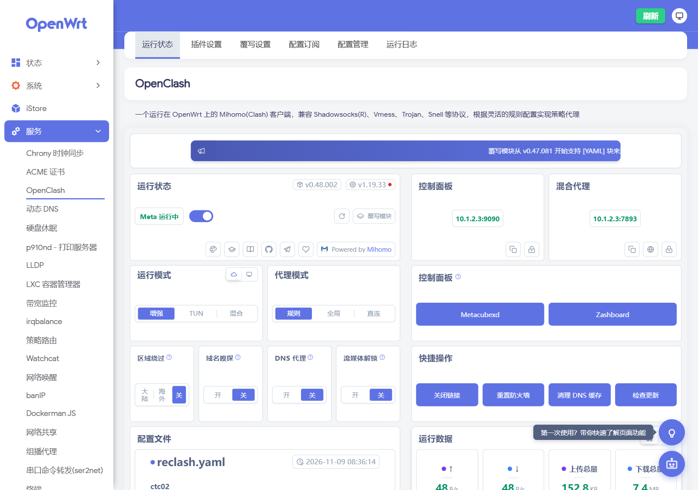

# Edge 610 OpenWrt 固件自动构建

为 **VMware SD-WAN Edge 610**（Dell EMC VEP1400 同款硬件）定制的 OpenWrt 镜像，GitHub Actions 一键全源码构建。

- 目标机：Intel Atom **C3308**（2C/2T 1.6GHz，无 AVX/AVX2）/ 4GB DDR4 / 16GB eMMC（`/dev/mmcblk0`，14.6GiB 可用）/ 无显示输出（Micro-USB 串口 115200 8N1）
- 交换：2× SFP（SoC 原生 X553，`ixgbe`）+ 6× RJ45（板载 Marvell 88E6190，DSA `lan1..lan6`）
- 看门狗：板载 PIC 硬件 WDT（iSMT SMBus `0x22/0x24`），开机由脚本清除，否则 4~5 分钟硬重启

## 界面预览

| 状态概览 | 网络接口 |
| --- | --- |
|  |  |

| OpenClash |
| --- |
|  |

> 截图为实机 LuCI（Argon v3 + 中文），该机 LAN 已改为 `10.1.2.3/24`；镜像默认是 `192.168.1.1/24`。

## 硬件实测（本机）

| 项目 | 实测值 |
| --- | --- |
| CPU | `Intel(R) Atom(TM) CPU C3308 @ 1.60GHz`（交接文档里写的 C3338 是错的） |
| 内存 | 4,003,672 kB ≈ 3.8 GiB |
| eMMC | `mmc0:0001 AJTD4R` 14.6 GiB（`/dev/mmcblk0`；HS400，实测顺序读 ~293 MB/s。镜像布局：p1 16M vfat `/boot`、p2 rootfs、p128 239K BIOS boot） |
| 网卡 | 4× `8086:15c3` X553 Backplane（BIOS 显示 Chip Type **X550**） |
| 网口映射 | `eth0` = `03:00.0` = 交换 CPU 链路（本机 **CPU port 10**，conduit）；`eth1` = `03:00.1` 未使用；`eth2` = `05:00.0`、`eth3` = `05:00.1` = 两个 SFP 口 |
| SFP 速率 | **只有 1G**（不支持 2.5G，也不支持 10G）。Dell 规格书：Edge 610 = `2×1G SFP`，620/640/680 才是 `2×10G SFP+`；四个 X553 全是 `8086:15c3` = `X550EM_A_KR_L`（1G 背板版），驱动对该 device ID 只返回 1G。实测强制 2.5GBASE-X（`x553_speed=2500` + 交换机 `MAC_CTL=0x303f`）链路仍锁定 1G |
| WiFi | `168c:003c` QCA986x/988x（ath10k + `ath10k-firmware-qca988x`） |

> 为什么不用 ImageBuilder：官方 x86 预编译内核关闭了 `CONFIG_NET_DSA` / `MV88E6XXX`，没有 `i2c-ismt`，也无法编译本机所需的外挂内核模块。因此本仓库改为 **全源码构建** OpenWrt 25.12.6。

## 速率上限（重要）

| 接口 | 上限 | 依据 |
| --- | --- | --- |
| 6×RJ45 `lan1..lan6` | **1G/口** | Marvell 88E6190 是千兆交换机 |
| 2×SFP | **1G** | Dell 规格书 Edge 610 = `2×1G SFP`；X553 是 `8086:15c3`（KR_L，1G 背板版） |
| 内部 CPU 链路（交换机 ↔ X553） | **1G** | 硬件可配 2.5GBASE-X，实测强制后链路仍锁 1G |

- **不支持 2.5G**：SFP 驱动能力表只有 1G/10G；CPU 链路实测 2.5G 起不来（`x553_speed=2500` + `MAC_CTL=0x303f` 仍 1G）。
- **不支持 10G**：10G SFP+ 只在 Edge 620/640/680（4/8/16 核）上；610 的 X553 被 strap 成 KR_L（1G）。
- 想要 2.5G/10G：换 620 以上机型，或外接 USB 2.5G 网卡（镜像已含 `kmod-usb-net-rtl8152`）。

## 构建产物

Actions 运行成功后下载 artifact `Edge610-OpenWrt-Image`（zip 内）：

| 文件 | 说明 |
| --- | --- |
| `openwrt-x86-64-generic-ext4-combined-efi.img.gz` | **刷机用镜像**（EFI，根分区 1024MB，构建系统默认名） |
| `edge610-YYYYMMDD-HHMM.img.gz` | 同一镜像的**带时间戳副本**（GMT+8；CI 与本机构建都会生成） |
| `openwrt-x86-64.manifest` | 已安装软件包清单 |
| `sha256sums` | 校验和 |

## 一键构建

1. 打开 Actions → **Build Edge 610 OpenWrt Image** → *Run workflow*（main 分支）。
2. 全程约 3.5~4 小时（4 核 runner 全源码构建 + 工具链）。失败时自动上传 `build-log` artifact（含 `build.log` / `dl.log`）。

### 本地构建（推荐用于迭代）

CI 每次都是全新 runner，必须重编 rustc + 工具链（约 70% 时间）。本地/VM 有缓存，**首次约 75 分钟，之后改包通常 3~10 分钟出镜像**。

```bash
# 要求：Ubuntu 24.04 x86_64，≥8 核，≥16GB 内存，≥60GB 空闲磁盘（ext4）
PROXY=http://192.168.68.1:7897 ./scripts/build-local.sh
```

- `PROXY` 可选：GitHub / OpenWrt 源在部分网络下不稳定时填本机代理。
- 脚本与 CI 完全同源（同 feeds pin、同 `.config` 种子、同 ixgbe autoload 剥离、同结尾校验），幂等可重跑。
- 产物：`~/work/openwrt/bin/targets/x86/64/openwrt-x86-64-generic-ext4-combined-efi.img.gz`
- 已内置下载容错：`CURL_OPTIONS` 单文件 600s 上限 + 低速 60s 中断，下载失败自动重试 3 次。

## 镜像内容

| 组件 | 版本 / 说明 |
| --- | --- |
| OpenWrt | 25.12.6（x86_64，kernel 6.12.112） |
| LuCI | 官方 feed |
| OpenClash | 0.48.002（官方稳定 release tag） |
| Mihomo 内核 | v1.19.33 `linux-amd64-v1`（**无 AVX2**，预置于 `/etc/openclash/core/clash_meta`） |
| DNS | `dnsmasq-full`（替换默认 dnsmasq） |
| 交换 | `kmod-dsa` + `kmod-dsa-mv88e6xxx` + 本仓库 `edge610_dsa`（端口名 `lan1..lan6`） |
| 网卡 | `kmod-ixgbe`（**autoload 已剥离**，由 init 脚本按序加载） |
| 看门狗总线 | `kmod-i2c-ismt` + `i2c-tools` |
| 温度 | `kmod-hwmon-coretemp` + `lm-sensors`（Denverton 走 MSR，`/sys/class/thermal` 有 zone） |
| WiFi | `kmod-ath10k` + `ath10k-firmware-qca988x`（板上 QCA986x/988x，默认未配置接口） |
| 默认网络 | `br-lan` = `lan1..lan6`，静态 `192.168.1.1/24`；**不预置 WAN**（`eth2`/`eth3` 留空，由用户在 LuCI 里自行分配） |
| 根分区 | 镜像内 1 GiB；**首启自动扩容到整块 eMMC**（`sfdisk` + `partx` + `resize2fs`） |
| 主题 | **Argon v3**（`jerrykuku/luci-theme-argon`，master；v3 起配置页内置在主题包） |
| 预置插件（基础） | LuCI 中文、`ttyd`（Web 终端）、`package-manager`、`statistics`、`ddns`、`sqm`、`wireguard`、`firewall` |
| 安全/证书 | `acme`+`uhttpd`（Let's Encrypt HTTPS）、`banip`（爆破封禁）、`acl`（多用户权限） |
| 虚拟化 | `lxc`（LXC 容器） |
| 加速/组网 | `kmod-tcp-bbr`（BBR 拥塞控制）、`zerotier`（组网，GUI 走 iStore）、`luci-app-wifischedule`（无线定时） |
| 对时/测速/流量 | `chrony`（精准对时）、`librespeed`（内网测速，可验证千兆线速）、`vnstat2`（流量历史） |
| 网络 | `mwan3`（多 WAN，配合双 SFP）、`pbr`（策略路由）、`upnp`、`nlbwmon`（流量统计）、`wol`、`udpxy`（IPTV 组播转单播）、`omcproxy`、`watchcat`（断网自愈）、`lldpd` |
| DNS/去广告 | **不预置**（按需 `apk add luci-app-adguardhome` / `luci-app-smartdns` / `luci-app-adblock-fast`） |
| 存储/共享 | `ksmbd`（SMB）、`hd-idle`、`filebrowser`（aria2/transmission 按需 `apk add`） |
| 磁盘/文件系统 | `kmod-fs-exfat` / `vfat` / `ntfs3`、`kmod-usb-printer`、`e2fsprogs`、`smartmontools`、`hdparm` |
| 运维 | `commands`、`irqbalance`、`p910nd`（USB 打印）、`ser2net`、`filemanager` |
| VPN/穿透 | 仅内核+协议（`kmod-wireguard`、`wireguard-tools`、`luci-proto-wireguard`）；openvpn/tailscale/frpc 按需 `apk add` |
| 容器 | **内置 docker**：`dockerd`/`containerd`/`runc`/`tini`/`docker` CLI/`docker-compose` + `luci-app-dockerman`（内核依赖 veth/ipt-nat/ipt-physdev/nf-ipvs 一并内置） |
| 诊断工具 | `ethtool` `tcpdump` `htop` `mtr` `iperf3` `iftop` `bind-host`(dig) `nano` `pciutils`(lspci) `usbutils`(lsusb) `lm-sensors` `block-mount` |
| USB 扩展 | `kmod-usb-net-rtl8152` / `asix-ax88179` / `cdc-ether`（USB 网卡或手机共享作 WAN）、`kmod-usb-storage`、`kmod-fs-ext4` |

## 仓库结构

```
.github/workflows/build.yml       全源码构建流水线（14 步，含断言与镜像校验）
patches/openwrt/0001-image-mkfs-ext4-use-mke2fs.patch  rootfs 改用 mke2fs（在线扩容）
package/edge610-board/
├── Makefile                      三个内核包 + 板级包定义
├── src/
│   ├── edge610_switch_standalone.c   ixgbe 加载前初始化 X553/交换芯片
│   ├── edge610_dsa.c                 注册 88E6190 DSA（端口 lan1..lan6）
│   └── Makefile
└── files/
    ├── etc/init.d/edge610           看门狗关闭 + 有序探测（standalone → ixgbe → DSA）
    ├── etc/modprobe.d/edge610.conf  板级模块参数
    ├── etc/uci-defaults/zzz99-edge610-network  首启网络配置（仅 LAN，无 WAN）
    └── etc/openclash/core/          clash_meta 由 CI 下载（已 gitignore）
```

### 关键设计

- **加载顺序**：`ixgbe` 的 autoload 在构建时被删除，`/etc/init.d/edge610`（START=19，早于 network）依次执行：
  `insmod edge610_switch_standalone cpu_port=0 x553_sgmii=1 cpu_mac_ctl=0x203e serdes_autoneg=1` → `modprobe ixgbe` → `modprobe mv88e6xxx` → `insmod edge610_dsa conduit_name=<ethX> force_cpu_phyctl=0x203e`。
  （busybox 的 `modprobe` 会静默丢弃 `name=value`，所以板级模块用 `insmod` 传参。）
- **conduit 检测**：优先 PCI `0000:03:00.0` 的 netdev；回退取 ixgbe 中 MAC 最小的网口（conduit 是四个连续 X553 MAC 的第一个）。conduit 口只置 up，不配地址。
- **看门狗**：扫描 `/sys/bus/i2c/devices/*/name` 中的 `iSMT` 适配器，向 `0x22`/`0x24` 写 `0x00`；失败仅记录日志，不阻塞启动。
- **端口改名**：`edge610_dsa` 中端口名由上游 `ge1..ge6` 改为 `lan1..lan6`，与 OpenWrt DSA 惯例及网络默认配置一致。
- **根分区**：`CONFIG_TARGET_ROOTFS_PARTSIZE=1024`（默认 104MB 装不下 mihomo + ruby 等），首启由 `zzz98-edge610-resize` 在线扩到整盘。
  前提是镜像用 `mkfs.ext4` 而不是 OpenWrt 默认的 `make_ext4fs` 生成：后者的 resize inode 布局会让内核在线扩容报
  `reserve_backup_gdb: reserved block 64 not at offset 63`（[openwrt#7729](https://github.com/openwrt/openwrt/issues/7729)）。
  本仓库用 `patches/openwrt/0001-image-mkfs-ext4-use-mke2fs.patch` 替换 `Image/mkfs/ext4`（在 fakeroot 里 `chown -R 0:0`，保证镜像内属主为 root）。

## 刷机

> 必须用本仓库构建的镜像（已打 mke2fs 补丁）。用 OpenWrt 默认 `make_ext4fs` 生成的镜像，
> 首启在线扩容会失败（openwrt/openwrt#7729）。

1. 准备 U 盘：一个 OpenWrt 启动盘 + 一个 exfat 数据分区，把 `edge610-*.img.gz` 放进数据分区。
2. 拆背板小铁片露出 Micro-USB 串口（CP210x），PuTTY：`115200 8N1`、无流控。
3. 插 U 盘开机，F12 选 USB 启动，进入 OpenWrt 后：

   ```sh
   lsblk                                   # 确认 /dev/mmcblk0 为 eMMC
   mkdir -p /mnt/usb && mount /dev/sdbX /mnt/usb
   gzip -dc /mnt/usb/edge610-*.img.gz | dd of=/dev/mmcblk0 bs=4M conv=fsync
   sync
   ```

4. 拔 U 盘，`reboot`。首启 `zzz98-edge610-resize` 自动把根分区扩到整盘，
   `df -h /` 应为 ~14.3G（日志：`logread -e edge610-resize`）。

## 开机验收

串口执行：

```sh
ip link                     # 应出现 lan1..lan6（+ lo 与若干 ethX）
logread -e edge610          # 看门狗清除、conduit、端口 up 日志
df -h /                     # 从 eMMC 启动应为 ~14.3G（首启扩容生效）
sensors                     # 应看到 Core 0/Core 1 温度（kmod-hwmon-coretemp）
/etc/openclash/core/clash_meta -v   # 必须回显 Mihomo Meta ... linux amd64（amd64-v1）
```

- 空闲运行 ≥10 分钟不重启 → 看门狗关闭生效。
- 网线接 **LAN1**，浏览器打开 `http://192.168.1.1` → LuCI。
- 服务 → OpenClash：载入订阅配置，启动代理。

## 实现历程与关键发现

完整的调试时间线（含证据、串口日志、构建耗时）见 [`docs/bringup-log.md`](docs/bringup-log.md)。

这台机器踩过的三个坑，维护时值得记住：

| 坑 | 现象 | 处理 |
| --- | --- | --- |
| BIOS 隐藏 P2SB（`8086:19dd` 不在 `lspci`） | 模块静默 `-ENODEV`，`ixgbe` 不加载，只有 `lo` | 模块从 `/proc/iomem` 的 `INTC3000:00` 反推 BAR（本机 `0xFD000000`）；可参数 `p2sb_bar_addr=` 覆盖 |
| uci section 名不允许 `-` | `uci: Parse error (invalid character in name field)`，网桥不生效 | `config device` 匿名 + `option name 'br-lan'`（构建期已有断言） |
| `make download` 无总超时 | 半死连接无限挂起，构建看似"卡住" | `CURL_OPTIONS=--max-time 600 --speed-time 60 --speed-limit 1024` + 重试 |

## 故障排查

| 现象 | 处理 |
| --- | --- |
| `ip link` 无 `lan1..lan6` | `logread -e edge610` 看 `edge610_switch_standalone` / `edge610_dsa` 报错；`dmesg \| grep -i -E 'dsa\|mv88e'`；`lsmod \| grep -E 'edge610\|mv88e\|dsa'` |
| 日志 `P2SB BAR unavailable` | 该机 BIOS 隐藏了 P2SB（`8086:19dd` 不在 `lspci` 里）。模块会从 `/proc/iomem` 的 `INTC3000:00` 反推 BAR（通常 `0xfd000000`）；仍失败时手动指定：`modprobe edge610_switch_standalone p2sb_bar_addr=0xfd000000 ...` 和 `modprobe edge610_dsa conduit_name=ethX p2sb_bar_addr=0xfd000000` |
| 4~5 分钟自动重启 | 看门狗未关：`logread -e edge610` 应无 `iSMT SMBus adapter not found`。手动确认：`modprobe i2c-ismt; grep . /sys/bus/i2c/devices/*/name`，然后 `i2cset -y <bus> 0x22 0 0 b` |
| Mihomo 报 `Illegal instruction` | 核被替换成了 v2/v3（AVX）。只可用 `linux-amd64-v1`，重新放回 `/etc/openclash/core/clash_meta` |
| 没有 WAN | 默认不预置 WAN：`br-lan` 只含 `lan1..lan6`，`eth2`/`eth3`（SFP）保持未配置。需要 WAN 时在 LuCI「网络→接口→添加」里自己建，设备可选 `lan1..lan6` 或 `eth2/eth3`（`logread -e edge610` 里的 `conduit:` 是交换 uplink，**不要**配地址） |
| eth 口数量不止 eth0/eth1 | X553 共 4 个 MAC，枚举数量随 BIOS 变化；以日志中 `conduit:` 行与实际插线为准 |

## 修改与重建

- 改镜像内容：编辑 `package/edge610-board/` 或 workflow 中的 `.config` 种子 → commit 推送 → Actions 重跑。
- `.config` 种子中的关键包在构建时会被断言（defconfig 后 grep 校验），缺失即失败，避免“构建成功但内容不对”。
- 构建末尾会校验：镜像存在且大小合理、manifest 含关键包、rootfs 内含模块与脚本、`clash_meta` 可执行且回显 Mihomo。
