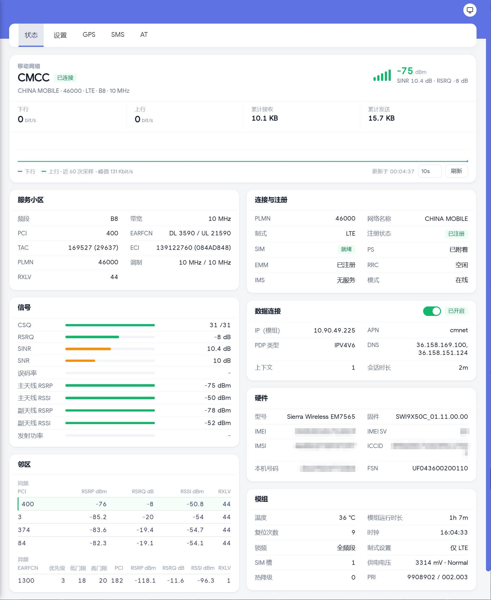
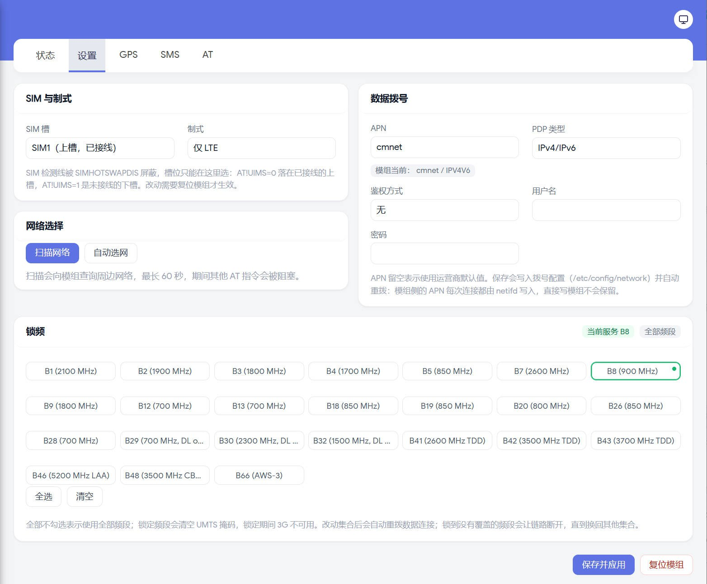
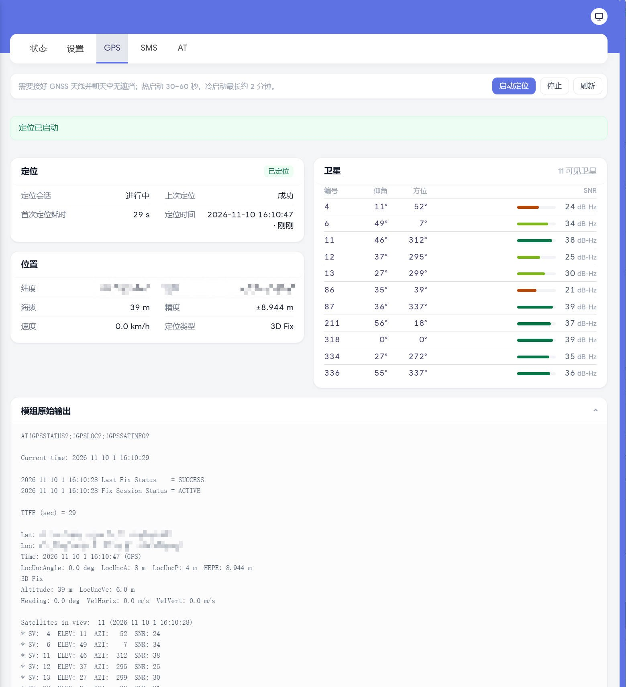
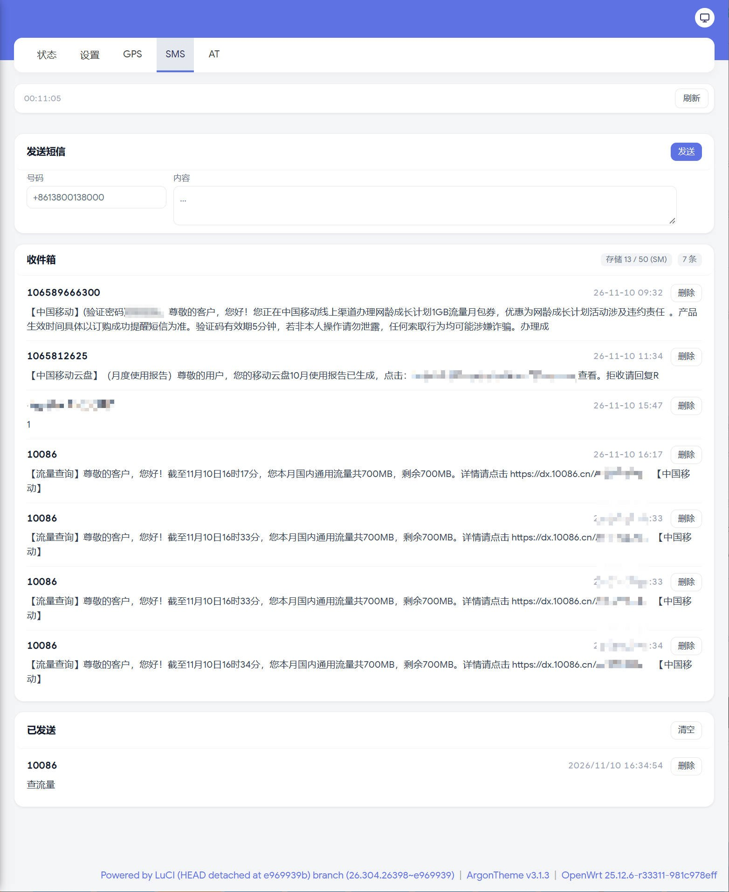
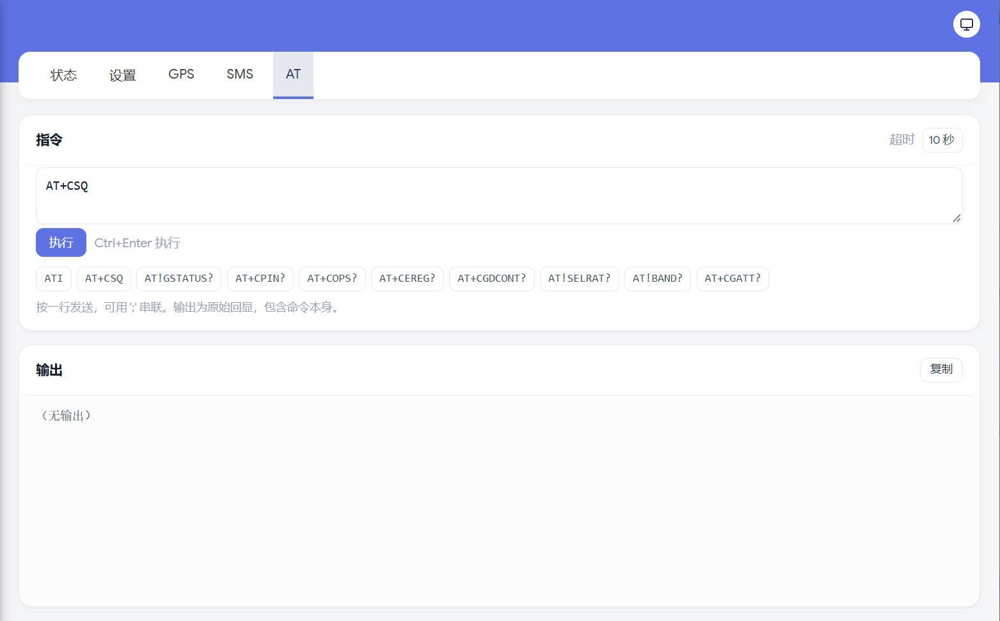

# Edge 610 OpenWrt 固件自动构建

**简体中文** | [English](README.en.md)

为 **VMware SD-WAN Edge 610**（Dell EMC VEP1400 同款硬件）定制的 OpenWrt 镜像，GitHub Actions 一键全源码构建。

- 目标机：Intel Atom **C3308**（2C/2T 1.6GHz，无 AVX/AVX2）/ 4GB DDR4 / 16GB eMMC（`/dev/mmcblk0`，14.6GiB 可用）/ 无显示输出（Micro-USB 串口 115200 8N1）
- 网络：2× **1G SFP**（SoC 原生 X553，`ixgbe`）+ 6× **1G RJ45**（板载 Marvell 88E6190，DSA `lan1..lan6`）——全部端口上限 1G，见[速率上限](#速率上限重要)
- 看门狗：板载 PIC 硬件 WDT（iSMT SMBus `0x22/0x24`），开机由脚本清除，否则 4~5 分钟硬重启

## 界面预览

| 状态概览 |
| --- |
|  |

| 网络接口 | 实时流量（千兆打满） |
| --- | --- |
|  |  |

| 挂载点（根分区已扩容） | Docker |
| --- | --- |
|  |  |

> 实机截图：Argon v3 主题 + 中文界面。该机 LAN 为 `10.1.2.3/24`，镜像默认 `192.168.1.1/24`。

### 4G/LTE 模组（EM7565）

状态 → **Modem** 下有五个页签，全部由本仓库的 `edge610-board` 包提供，不依赖额外插件：

| 页签 | 内容 |
| --- | --- |
| 状态 | 首屏直接给结论：链路（运营商 / 制式 / 频段 / 附着）、信号（RSRP 主值 + SINR/RSRQ + 近 60 次采样折线）、实时上下行与累计流量；下面是服务小区、连接与注册、信号条、数据连接、硬件、邻区（同频 / 异频）、模组状态 |
| 设置 | SIM 槽（`AT!UIMS`）、制式（`AT!SELRAT`）、扫描 / 自动选网、APN 与鉴权、频段锁（`AT!BAND`，改动即重拨）；右上角**复位模组**（`AT+CFUN=1,1`） |
| GPS | 启动/停止定位、经纬度与首次定位耗时（TTFF）、可见卫星（仰角 / 方位 / SNR）、`AT!GPSSTATUS?;!GPSLOC?;!GPSSATINFO?` 原始输出 |
| 短信 | 发送、收件箱（按条删除）、已发送（单条删除 / 清空） |
| AT | 原始 AT 调试：快捷命令、超时、`;` 串联、输出复制 |

| 状态（首屏即结论） |
| --- |
|  |

| 设置 | GPS |
| --- | --- |
|  |  |

| 短信 | AT |
| --- | --- |
|  |  |

页面之外，镜像还带这些：

- **首启建接口**：`zzz99-edge610-network-modem` 创建 `network.wwan`（qmi / `/dev/cdc-wdm0` / `apn cmnet` / `pdptype ipv4v6` / `metric 100`）并加入防火墙 `wan` zone；已有 `lan` 配置时不重写 `/etc/config/network`。
- **出口顺序**：有线 `lan6`（WAN，DHCP，metric 0）优先，LTE 是 metric 100 的备用，只有有线的默认路由消失时 netifd 才回落；没有健康检查，要做主动切换就启用 mwan3（默认关闭）。
- **`modem-at`**：自动探测 AT 口（option 驱动的序号随 USB 组合变化，可能是 `ttyUSB1` 或 `ttyUSB2`），用 `flock` 与页面轮询互斥。
- **`modem-wan-watch`**：30 s 循环。SIM 每 60 s 用 QMI 查一次槽 1，连续两次非 `present` → `ifdown wwan` + `AT+CFUN=1,1`（10 分钟节流），卡可读且 `auto=1` → `ifup`；同时比对 `AT+CGPADDR` 与 `wwan0` 地址，PDP 地址漂移就重拨（退避 120→900 s）。
- **速率的口径**：QMI WDS 只给会话参数（IP / 网关 / DNS / MTU），没有“协商速率”这种字段；空口能力看 `AT!GSTATUS?`（频段 / 带宽 / CA），实际吞吐看 `wwan0` 计数差分——首屏的“下行 / 上行”是相邻两次轮询的平均值，刷新间隔越大越平滑。

已知限制：

- **换卡必须复位**：SIM 检测线被 `AT!CUSTOM="SIMHOTSWAPDIS",1` 屏蔽，热插拔后模组不会自己重新初始化；拔插后点一次「复位模组」，实测约 50 s 恢复注册与拨号。
- **只能插上槽**：`AT!UIMS=0` 落在已接线的槽 1，`AT!UIMS=1` 是未接线的槽 2，`AT!UIMS=2` 该固件直接回 `ERROR`。
- **AT 页没有命令白名单**：有 LuCI 权限即可发 `AT!RESET`、`AT!USBCOMP` 等，改错会丢 AT 口。串联时个别查询（如 `AT!SELRAT?`）会回 `Unknown RAT mode`，需单独发送。

> 模组截图中的 IMEI / IMSI / ICCID / 本机号码 / 短信验证码 / 坐标已打码。

## 实机照片

| 正面 | 背面 |
| --- | --- |
|  |  |

> 背面从左到右：MAIN/GPS 天线座、2× SFP（标注 1/2）、GE1/GE2、GE3/GE4、AUX；Micro-USB 串口在背板小铁片后。

## 硬件实测（本机）

| 项目 | 实测值 |
| --- | --- |
| CPU | `Intel(R) Atom(TM) CPU C3308 @ 1.60GHz`（2C/2T，无 AVX/AVX2） |
| 内存 | 4,003,672 kB ≈ 3.8 GiB |
| eMMC | `mmc0:0001 AJTD4R` 14.6 GiB（`/dev/mmcblk0`；HS400，实测顺序读 ~293 MB/s。镜像布局：p1 **128M** vfat `/boot`、p2 rootfs、p128 239K BIOS boot。p1 要放 keep-config 升级的配置备份，16M 装不下带 openclash 的备份） |
| 网卡 | 4× `8086:15c3` X553 Backplane（BIOS 显示 Chip Type **X550**） |
| 网口映射 | `eth0` = `03:00.0` = 交换 CPU 链路（本机 **CPU port 10**，conduit）；`eth1` = `03:00.1` 未使用；`eth2` = `05:00.0`、`eth3` = `05:00.1` = 两个 SFP 口 |
| SFP 速率 | **只有 1G**（不支持 2.5G，也不支持 10G）。Dell 规格书：Edge 610 = `2×1G SFP`，620/640/680 才是 `2×10G SFP+`；四个 X553 全是 `8086:15c3` = `X550EM_A_KR_L`（1G 背板版），驱动对该 device ID 只返回 1G。实测强制 2.5GBASE-X（`x553_speed=2500` + 交换机 `MAC_CTL=0x303f`）链路仍锁定 1G |
| WiFi | `168c:003c` QCA986x/988x（ath10k + `ath10k-firmware-qca988x`） |

> 为什么不用 ImageBuilder：官方 x86 预编译内核关闭了 `CONFIG_NET_DSA` / `MV88E6XXX`，没有 `i2c-ismt`，也无法编译本机所需的外挂内核模块。因此本仓库改为 **全源码构建** OpenWrt 25.12.6。

## CPU 性能实测

C3308 没有 PassMark 条目（太冷门），用 **CoreMark 1.0** 实测（本机 OpenWrt 25.12.6，空闲系统）：

| 项目 | 实测值 |
| --- | --- |
| CoreMark 1.0（单线程） | **7,786.51** iterations/sec（110,000 次迭代，14.13 s，CRC 校验通过） |
| CoreMark 1.0（2 线程） | **14,582.09**（`-DMULTITHREAD=2 -DUSE_FORK=1`，扩展比 1.87×） |
| 每 MHz | 7,786 / 1600 ≈ **4.87 CoreMark/MHz**（Goldmont 乱序核） |
| 编译器 | GCC 14.3.0（OpenWrt 工具链），`-O2 -DPERFORMANCE_RUN=1 -lrt` |
| 对照（单线程） | Raspberry Pi 4 @1.5 GHz：8,257；RPi 3：3,800；i5-3320M：21,245；i3-10100：30,532 |
| 对照（PassMark） | 同系列 C3338：单核 1,028 / 多核 1,834（C3308 频率更低，同一档） |

OpenSSL 加解密（`openssl speed`，AES-NI 生效）：

| 算法 | 1 KB | 16 KB |
| --- | --- | --- |
| AES-128-CBC | 411 MB/s | 418 MB/s |
| AES-256-GCM | 403 MB/s | 547 MB/s |
| SHA-256 | 300 MB/s | 381 MB/s |
| ChaCha20-Poly1305 | 261 MB/s | 271 MB/s |

复现：

```bash
git clone --depth 1 https://github.com/eembc/coremark.git && cd coremark
make PORTABLE=1 PORT_DIR=linux \
  CC=<staging_dir>/toolchain-x86_64_gcc-14.3.0_musl/bin/x86_64-openwrt-linux-musl-gcc \
  ITERATIONS=100000
# 把 coremark.exe 拷到设备执行 ./coremark
```

## 其他板载硬件（实测）

| 硬件 | 状态 |
| --- | --- |
| **Sierra Wireless EM7565** LTE-A Cat-12 模组（USB `1199:9091`，SN `UF04360020011048`） | 自 `ec39bbf` 起镜像内置：option 驱动提供 AT 口，`qmi_wwan` 提供 `wwan0` + `cdc-wdm0`。背板 MAIN/AUX = LTE 主/副天线，**GPS = GNSS 天线**。实测详见 [docs/lte.md](docs/lte.md) |
| **GPS/GNSS** | 即 EM7565 的定位功能（GPS/GLONASS/BeiDou/Galileo/QZSS），原厂用于 SD-WAN 设备定位；OpenWrt 下可经 QMI LOC 或 `AT!GPS` 读取，需接 GPS 天线 |
| **小区参数查询** | PCI/ECGI/TAC/邻区/信号/APN 的 AT 与 QMI 命令速查：[docs/lte-cell-info.md](docs/lte-cell-info.md) · [全部 AT 命令](docs/lte-at-commands.md) |
| **Intel QuickAssist (QAT)** `8086:19e2` | 加密/压缩协处理器；OpenWrt 无驱动（需 Intel 外挂 qat17），未启用 |
| **QCA988x WiFi 5** `168c:003c` | ath10k 正常；默认配置 `disabled '1'`，`wifi reload` 后 `phy0-ap0`（5GHz/80MHz/23dBm）可用 |
| **SD Host 控制器** `8086:19db` | 驱动板载 eMMC（HS400），无第二个 mmc 设备 |
| **SMBus 设备** | `0x22`/`0x24` = PIC（看门狗控制，开机写 0 关停）；`0x40` = 电源/遥测；`0x50–0x57` = EEPROM/FRU；`0x20/0x21` 等只写不读 |
| **温度** | coretemp 50–56 °C；8 个交换机端口传感器 55–57 °C |
| **ME (HECI)** `8086:19d3` | 存在，无用途 |

## 速率上限（重要）

| 接口 | 上限 | 依据 |
| --- | --- | --- |
| 6×RJ45 `lan1..lan6` | **1G/口** | Marvell 88E6190 是千兆交换机 |
| 2×SFP | **1G** | Dell 规格书 Edge 610 = `2×1G SFP`；X553 是 `8086:15c3`（KR_L，1G 背板版） |
| 内部 CPU 链路（交换机 ↔ X553） | **1G** | 硬件可配 2.5GBASE-X，实测强制后链路仍锁 1G |

- **不支持 2.5G**：SFP 驱动能力表只有 1G/10G；CPU 链路实测 2.5G 起不来（`x553_speed=2500` + `MAC_CTL=0x303f` 仍 1G）。
- **不支持 10G**：10G SFP+ 只在 Edge 620/640/680（4/8/16 核）上；610 的 X553 被 strap 成 KR_L（1G）。
- 想要 2.5G/10G：换 620 以上机型，或外接 USB 2.5G 网卡（镜像已含 `kmod-usb-net-rtl8152`）。

### SFP 口实测

| 项 | 结论 |
|---|---|
| 端口映射 | 插模块后只有对应 netdev 能读出 EEPROM → **SFP1 = `eth3`（`05:00.1`）**，SFP2 = `eth2`（`05:00.0`） |
| 默认配置 | 两个笼子都是 `br-lan` 成员（`lan1..lan5` + `eth3` + `eth2`），插线即用；`lan6` 为 WAN |
| 模块 | 电口 SFP `OYJ-SFP-T`（OEM，1.25G，SN `82608030053` / `82608150004`，2026-11-04） |
| 链路 | SFP1 接 1G 对端：`NIC Link is Up 1 Gbps, Flow Control: RX/TX`，全双工，`rx_errors`/`rx_crc_errors` = 0 |
| 起链时序 | `ip link set up` 后模块 PHY 约 2 s 才起链，之前会看到一次 `Up → Down`；空槽时是 `NO-CARRIER` |
| 速率协商 | 主机侧固定 1G SGMII/背板（`Supported link modes: 1000baseKX`），10/100M 由模块自身 PHY 与对端协商 |
| DDM | 电口模块 A2 页是占位值（两个不同序列号逐字节相同、无光路仍报 Rx 功率），A2 `0x0180` 之后全 0 → 不能用于监控 |
| 热插拔 | 模块插入即被识别（EEPROM 可读），不需要额外驱动；端口是常驻桥成员 |

**为什么 610 上不了 2.5G/10G**：

- 本板 4 个口全是 `8086:15c3` = `X550EM_A_KR_L`；`ixgbe` 的 `ixgbe_get_link_capabilities_X550em()` 对 `phy.type == x550em_kr` + `device_id == KR_L` **直接返回 1G**。
- 2.5G 只有在该端口 NVM strap `IXGBE_NW_MNG_IF_SEL`（CSR `0x11178`）的 `PHY_SPEED_2_5G`(bit20) 置位时才给——本板未置位，且这不是插模块能改的。
- 10G 需要 `X550EM_A_SFP`(`15ce`)/`SFP_N`(`15c4`)/`KR`(`15c2`) 这类 SKU；`allow_unsupported_sfp=1` 也无效，因为 KR_L 走 `x550em_kr` 分支，从不调用 SFP 白名单路径。

| 机型 | SFP 口 | X553 配置 |
|---|---|---|
| Edge 610 | 2× **1G SFP** | KR_L（`15c3`） |
| Edge 620 / 640 / 680 | 2× **1G/10G SFP+** | SFP / SFP_N（`15ce` / `15c4`） |

> Edge 600 系列只有 610/620/640/680（另有 610C/610N/620C/620N/640N），**没有 630**。


## 构建产物

Actions 运行成功后下载 artifact `Edge610-OpenWrt-Image`（zip 内）：

| 文件 | 说明 |
| --- | --- |
| `openwrt-x86-64-generic-ext4-combined-efi.img.gz` | **刷机用镜像**（EFI，根分区 1024MB，构建系统默认名） |
| `edge610-YYYYMMDD-HHMM.img.gz` | 同一镜像的**带时间戳副本**（GMT+8；CI 与本机构建都会生成） |
| `openwrt-x86-64.manifest` | 已安装软件包清单 |
| `sha256sums` | 校验和 |

## 一键构建

1. 打开 Actions → **Build Edge 610 OpenWrt Image** → *Run workflow*（main 分支）。
2. 全程约 3.5~4 小时（4 核 runner 全源码构建 + 工具链）。失败时自动上传 `build-log` artifact（含 `build.log` / `dl.log`）。

### 本地构建（推荐用于迭代）

CI 每次都是全新 runner，必须重编 rustc + 工具链（约 70% 时间）。本地/VM 有缓存，**首次约 75 分钟，之后改包通常 3~10 分钟出镜像**。

```bash
# 要求：Ubuntu 24.04 x86_64，≥8 核，≥16GB 内存，≥60GB 空闲磁盘（ext4）
PROXY=http://192.168.68.1:7897 ./scripts/build-local.sh
```

- `PROXY` 可选：GitHub / OpenWrt 源在部分网络下不稳定时填本机代理。
- 脚本与 CI 完全同源（同 feeds pin、同 `.config` 种子、同 ixgbe autoload 剥离、同结尾校验），幂等可重跑。
- 产物：`~/work/openwrt/bin/targets/x86/64/openwrt-x86-64-generic-ext4-combined-efi.img.gz`
- 已内置下载容错：`CURL_OPTIONS` 单文件 600s 上限 + 低速 60s 中断，下载失败自动重试 3 次。

## 镜像内容

| 组件 | 版本 / 说明 |
| --- | --- |
| OpenWrt | 25.12.6（x86_64，kernel 6.12.112） |
| LuCI | 官方 feed |
| OpenHsalc | 0.48.002（官方稳定 release tag） |
| Mihomo 内核 | v1.19.33 `linux-amd64-v1`（**无 AVX2**，预置于 `/etc/openclash/core/clash_meta`） |
| DNS | `dnsmasq-full`（替换默认 dnsmasq） |
| 交换 | `kmod-dsa` + `kmod-dsa-mv88e6xxx` + 本仓库 `edge610_dsa`（端口名 `lan1..lan6`） |
| 网卡 | `kmod-ixgbe`（**autoload 已剥离**，由 init 脚本按序加载） |
| 看门狗总线 | `kmod-i2c-ismt` + `i2c-tools` |
| 温度 | `kmod-hwmon-coretemp` + `lm-sensors`（Denverton 走 MSR，`/sys/class/thermal` 有 zone） |
| CPU 微码 | `intel-microcode`（20251111；内核 `CONFIG_MICROCODE_LATE_LOADING`，preinit 写入 `/sys/devices/system/cpu/microcode/reload`。不装会报 `sh: write error: Invalid argument`，且 CPU 停在出厂修订、对应 RFDS 等漏洞） |
| WiFi | `kmod-ath10k` + `ath10k-firmware-qca988x`（板上 QCA986x/988x，默认未配置接口） |
| 默认网络 | `br-lan` = `lan1..lan5` + `eth3`/`eth2`（两个 SFP 笼），静态 `192.168.1.1/24`；**`lan6` 作 WAN**（DHCP 客户端，metric 0） |
| 根分区 | 镜像内 1 GiB；**首启自动扩容到整块 eMMC**（`sfdisk` + `partx` + `resize2fs`） |
| 默认密码 | 全新安装的 root 密码预置为 `edge610pass`（`zzz99-edge610-password` 只在 `/etc/shadow` 里 root 为空时写入；保留配置升级不会覆盖用户改过的密码）。**首次登录后请改掉** |
| 主题 | **Argon v3**（`jerrykuku/luci-theme-argon`，master；v3 起配置页内置在主题包） |
| 预置插件（基础） | LuCI 中文、`ttyd`（Web 终端）、`package-manager`、`statistics`、`ddns`、`sqm`、`wireguard`、`firewall` |
| 安全/证书 | `acme`+`uhttpd`（Let's Encrypt HTTPS）、`banip`（爆破封禁）、`acl`（多用户权限） |
| 虚拟化 | `lxc`（LXC 容器） |
| 加速/组网 | `kmod-tcp-bbr`（BBR 拥塞控制）、`zerotier`（组网，GUI 走 iStore）、`luci-app-wifischedule`（无线定时） |
| 对时/测速/流量 | `chrony`（精准对时）、`librespeed`（内网测速，可验证千兆线速）、`vnstat2`（流量历史） |
| 网络 | `mwan3`（多 WAN，配合双 SFP）、`pbr`（策略路由）、`upnp`、`nlbwmon`（流量统计）、`wol`、`udpxy`（IPTV 组播转单播）、`omcproxy`、`lldpd` |
| DNS/去广告 | **不预置**（按需 `apk add luci-app-adguardhome` / `luci-app-smartdns` / `luci-app-adblock-fast`） |
| 存储/共享 | `ksmbd`（SMB）、`hd-idle`、`filebrowser`（aria2/transmission 按需 `apk add`） |
| 磁盘/文件系统 | `kmod-fs-exfat` / `vfat` / `ntfs3`、`kmod-usb-printer`、`e2fsprogs`、`smartmontools`、`hdparm` |
| 运维 | `commands`、`irqbalance`、`p910nd`（USB 打印）、`ser2net`、`filemanager` |
| VPN/穿透 | 仅内核+协议（`kmod-wireguard`、`wireguard-tools`、`luci-proto-wireguard`）；openvpn/tailscale/frpc 按需 `apk add` |
| 容器 | **内置 docker**：`dockerd`/`containerd`/`runc`/`tini`/`docker` CLI/`docker-compose` + `luci-app-dockerman`（内核依赖 veth/ipt-nat/ipt-physdev/nf-ipvs 一并内置） |
| 诊断工具 | `ethtool`(full，`-m` 可解码 SFP EEPROM) `tcpdump` `htop` `mtr` `iperf3` `iftop` `bind-host`(dig) `nano` `pciutils`(lspci) `usbutils`(lsusb) `lm-sensors` `block-mount` |
| USB 扩展 | `kmod-usb-net-rtl8152` / `asix-ax88179` / `cdc-ether`（USB 网卡或手机共享作 WAN）、`kmod-usb-storage`、`kmod-fs-ext4` |

## 仓库结构

```
.github/workflows/build.yml       全源码构建流水线（14 步，含断言与镜像校验）
patches/openwrt/0001-image-mkfs-ext4-use-mke2fs.patch  rootfs 改用 mke2fs（在线扩容）
package/edge610-board/
├── Makefile                      三个内核包 + 板级包定义
├── src/
│   ├── edge610_switch_standalone.c   ixgbe 加载前初始化 X553/交换芯片
│   ├── edge610_dsa.c                 注册 88E6190 DSA（端口 lan1..lan6）
│   └── Makefile
└── files/
    ├── etc/init.d/edge610           看门狗关闭 + 有序探测（standalone → ixgbe → DSA）
    ├── etc/modprobe.d/edge610.conf  板级模块参数
    ├── etc/uci-defaults/zzz99-edge610-network  首启网络配置（lan1..lan5 为 LAN，lan6 为 WAN）
    ├── etc/uci-defaults/zzz99-edge610-network-modem  首启建 LTE 接口 network.wwan
    ├── usr/bin/modem-at            AT 口自动探测 + flock 互斥
    ├── usr/bin/modem-wan-watch     SIM / PDP 地址看门狗
    ├── usr/lib/lua/luci/controller/modem.lua         模组页面后端（AT/QMI 采集）
    ├── usr/lib/lua/luci/view/modem/                  状态 / 设置 / GPS / 短信 / AT 五个页面
    └── etc/openhsalc/core/          hsalc_meta 由 CI 下载（已 gitignore）
```

### 关键设计

- **加载顺序**：`ixgbe` 的 autoload 在构建时被删除，`/etc/init.d/edge610`（START=19，早于 network）依次执行：
  `insmod edge610_switch_standalone cpu_port=0 x553_sgmii=1 cpu_mac_ctl=0x203e serdes_autoneg=1` → `modprobe ixgbe` → `modprobe mv88e6xxx` → `insmod edge610_dsa conduit_name=<ethX> force_cpu_phyctl=0x203e`。
  （busybox 的 `modprobe` 会静默丢弃 `name=value`，所以板级模块用 `insmod` 传参。）
- **conduit 检测**：优先 PCI `0000:03:00.0` 的 netdev；回退取 ixgbe 中 MAC 最小的网口（conduit 是四个连续 X553 MAC 的第一个）。conduit 口只置 up，不配地址。
- **看门狗**：扫描 `/sys/bus/i2c/devices/*/name` 中的 `iSMT` 适配器，向 `0x22`/`0x24` 写 `0x00`；失败仅记录日志，不阻塞启动。
- **端口改名**：`edge610_dsa` 中端口名由上游 `ge1..ge6` 改为 `lan1..lan6`，与 OpenWrt DSA 惯例及网络默认配置一致。
- **根分区**：`CONFIG_TARGET_ROOTFS_PARTSIZE=1024`（默认 104MB 装不下 mihomo + ruby 等），首启由 `zzz98-edge610-resize` 在线扩到整盘。
  前提是镜像用 `mkfs.ext4` 而不是 OpenWrt 默认的 `make_ext4fs` 生成：后者的 resize inode 布局会让内核在线扩容报
  `reserve_backup_gdb: reserved block 64 not at offset 63`（[openwrt#7729](https://github.com/openwrt/openwrt/issues/7729)）。
  本仓库用 `patches/openwrt/0001-image-mkfs-ext4-use-mke2fs.patch` 替换 `Image/mkfs/ext4`（在 fakeroot 里 `chown -R 0:0`，保证镜像内属主为 root）。

## 只装板级包（不刷机）

如果机器上已经跑着 **OpenWrt 25.12.6 / kernel 6.12.112**，可以只装板级包，不必刷整镜像。

构建（在 OpenWrt 源码树里，已含本仓库的 `package/edge610-board`）：

```sh
make package/edge610-board/compile V=s
```

产物：

| 文件 | 说明 |
| --- | --- |
| `bin/packages/x86_64/base/edge610-board-*.apk` | 板级包：init 脚本 + modprobe 参数 + 首启网络 + mihomo 内核（约 25 MB） |
| `bin/targets/x86/64/packages/kmod-edge610-switch-*.apk` | 交换芯片初始化模块 |
| `bin/targets/x86/64/packages/kmod-edge610-dsa-*.apk` | DSA 注册模块 |
| `bin/targets/x86/64/packages/kmod-i2c-ismt-*.apk` | 看门狗总线驱动 |

安装：

```sh
apk add --allow-untrusted ./kmod-i2c-ismt-*.apk ./kmod-edge610-switch-*.apk \
    ./kmod-edge610-dsa-*.apk ./edge610-board-*.apk
/etc/init.d/edge610 enable
reboot
```

注意：

- **kmod 与内核版本严格绑定**（`6.12.112`），内核不一致会加载失败。
- 官方镜像里 `ixgbe` 开机自动加载，会抢在 `/etc/init.d/edge610` 之前 probe，X553 的 SGMII 模式来不及设置。
  只用包的话需要先删掉 ixgbe 的 autoload（`/etc/modules.d/` 中与 ixgbe 相关的文件），由 init 脚本按序加载；否则请直接用整镜像。

## 刷机

> 必须用本仓库构建的镜像（已打 mke2fs 补丁）。用 OpenWrt 默认 `make_ext4fs` 生成的镜像，
> 首启在线扩容会失败（openwrt/openwrt#7729）。

1. 准备 U 盘：一个 OpenWrt 启动盘 + 一个 exfat 数据分区，把 `edge610-*.img.gz` 放进数据分区。
2. 拆背板小铁片露出 Micro-USB 串口（CP210x），PuTTY：`115200 8N1`、无流控。
3. 插 U 盘开机，F12 选 USB 启动，进入 OpenWrt 后：

   ```sh
   lsblk                                   # 确认 /dev/mmcblk0 为 eMMC
   mkdir -p /mnt/usb && mount /dev/sdbX /mnt/usb
   gzip -dc /mnt/usb/edge610-*.img.gz | dd of=/dev/mmcblk0 bs=4M conv=fsync
   sync
   ```

4. 拔 U 盘，`reboot`。首启 `zzz98-edge610-resize` 自动把根分区扩到整盘，
   `df -h /` 应为 ~14.3G（日志：`logread -e edge610-resize`）。

## 开机验收

串口执行：

```sh
ip link                     # 应出现 lan1..lan6（+ lo 与若干 ethX）
logread -e edge610          # 看门狗清除、conduit、端口 up 日志
df -h /                     # 从 eMMC 启动应为 ~14.3G（首启扩容生效）
sensors                     # 应看到 Core 0/Core 1 温度（kmod-hwmon-coretemp）
/etc/openclash/core/clash_meta -v   # 必须回显 Mihomo Meta ... linux amd64（amd64-v1）
```

- 空闲运行 ≥10 分钟不重启 → 看门狗关闭生效。
- 网线接 **LAN1**，浏览器打开 `http://192.168.1.1` → LuCI。
- 服务 → OpenHsalc：载入订阅配置，启动代理。

## 实现历程与关键发现

完整的调试时间线（含证据、串口日志、构建耗时）见 [`docs/bringup-log.md`](docs/bringup-log.md)。

这台机器踩过的构建期坑，维护时值得记住：

| 坑 | 现象 | 处理 |
| --- | --- | --- |
| BIOS 隐藏 P2SB（`8086:19dd` 不在 `lspci`） | 模块静默 `-ENODEV`，`ixgbe` 不加载，只有 `lo` | 模块从 `/proc/iomem` 的 `INTC3000:00` 反推 BAR（本机 `0xFD000000`）；可参数 `p2sb_bar_addr=` 覆盖 |
| uci section 名不允许 `-` | `uci: Parse error (invalid character in name field)`，网桥不生效 | `config device` 匿名 + `option name 'br-lan'`（构建期已有断言） |
| `make download` 无总超时 | 半死连接无限挂起，构建看似"卡住" | `CURL_OPTIONS=--max-time 600 --speed-time 60 --speed-limit 1024` + 重试 |

## 故障排查

| 现象 | 处理 |
| --- | --- |
| `ip link` 无 `lan1..lan6` | `logread -e edge610` 看 `edge610_switch_standalone` / `edge610_dsa` 报错；`dmesg \| grep -i -E 'dsa\|mv88e'`；`lsmod \| grep -E 'edge610\|mv88e\|dsa'` |
| 日志 `P2SB BAR unavailable` | 该机 BIOS 隐藏了 P2SB（`8086:19dd` 不在 `lspci` 里），模块从 `/proc/iomem` 的 `INTC3000:00` 反推 BAR（通常 `0xfd000000`）。注意该窗口有时在根层、有时套在根级 `Reserved` 下（`grep -n INTC3000 /proc/iomem` 看缩进），模块已改为递归扫描；仍失败时手动指定：`modprobe ... p2sb_bar_addr=0xfd000000`（详见 `docs/bringup-log.md`） |
| 4~5 分钟自动重启 | 看门狗未关：`logread -e edge610` 应无 `iSMT SMBus adapter not found`。手动确认：`modprobe i2c-ismt; grep . /sys/bus/i2c/devices/*/name`，然后 `i2cset -y <bus> 0x22 0 0 b` |
| Mihomo 报 `Illegal instruction` | 核被替换成了 v2/v3（AVX）。只可用 `linux-amd64-v1`，重新放回 `/etc/openclash/core/clash_meta` |
| 没有 WAN / 想换 WAN 口 | 默认 `lan6` 是 WAN（DHCP 客户端），`br-lan` 含 `lan1..lan5` + 两个 SFP（`eth3`/`eth2`）。换口：LuCI「网络→接口」把 `wan` 的设备改成 `lanN` / `eth2` / `eth3`（`logread -e edge610` 里的 `conduit:` 是交换 uplink，**不要**配地址） |
| eth 口数量不止 eth0/eth1 | X553 共 4 个 MAC，枚举数量随 BIOS 变化；以日志中 `conduit:` 行与实际插线为准 |

## 修改与重建

- 改镜像内容：编辑 `package/edge610-board/` 或 workflow 中的 `.config` 种子 → commit 推送 → Actions 重跑。
- `.config` 种子中的关键包在构建时会被断言（defconfig 后 grep 校验），缺失即失败，避免“构建成功但内容不对”。
- 构建末尾会校验：镜像存在且大小合理、manifest 含关键包、rootfs 内含模块与脚本、`hsalc_meta` 可执行且回显 Mihomo。
