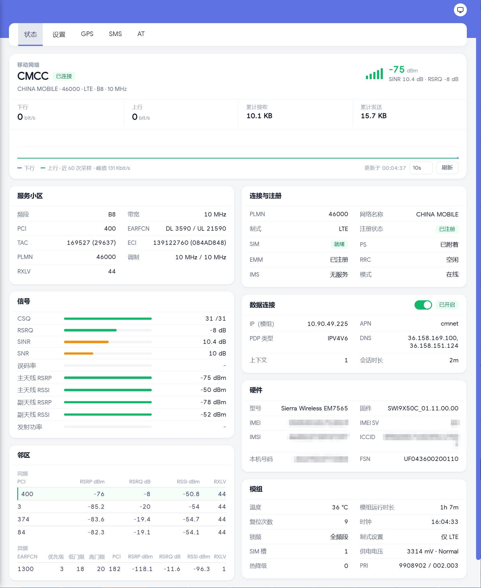
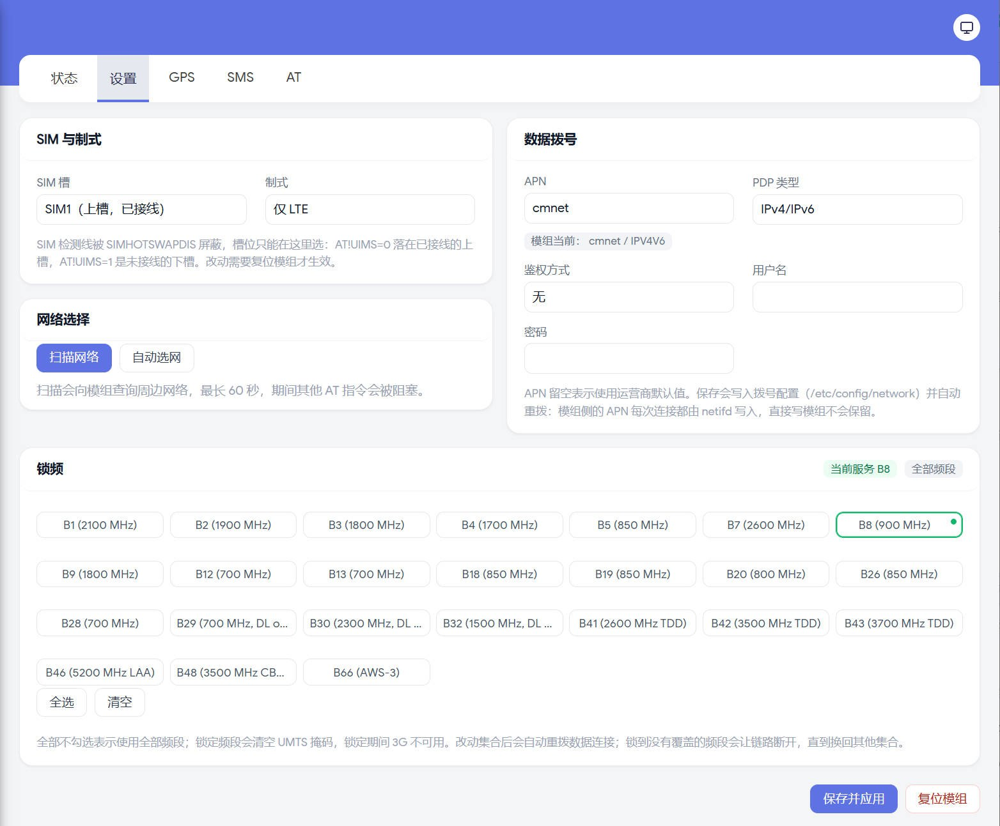
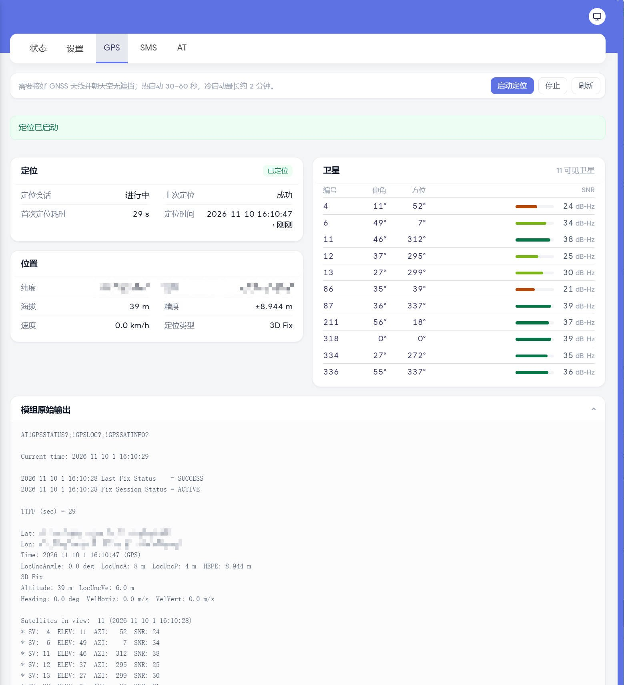
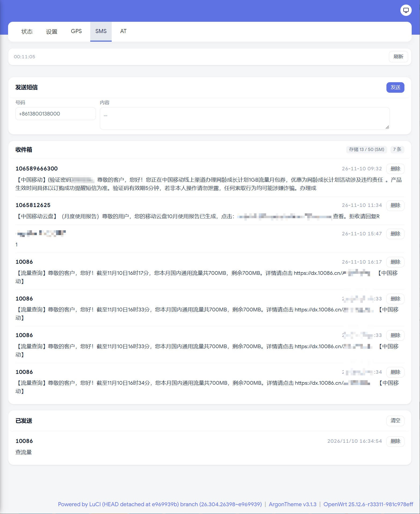
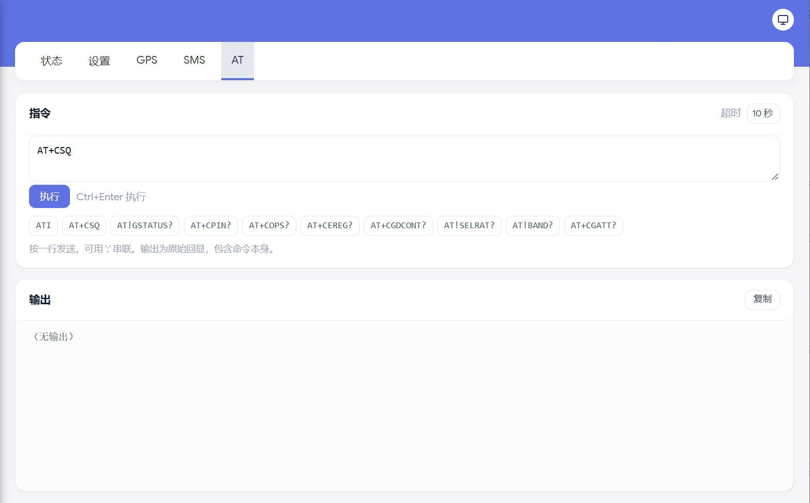

# Onboard LTE module (EM7565) — test notes

> Chinese version: [lte.md](lte.md)

> DMI: `EDGE610VWL` (Verizon LTE variant), onboard Sierra Wireless EM7565.
> Tested 2026-11-09 on OpenWrt 25.12.6, kernel 6.12.112.

## Hardware

| Item | Value |
| --- | --- |
| Module | Sierra Wireless **EM7565** (USB `1199:9091`, SN `UF04360020011048`) |
| Firmware | `SWI9X50C_01.11.00.00` GENERIC (2019-06-28) |
| IMEI | `353533101712019` |
| SIM slots | Two micro-SIM slots, **only the upper SIM1 is wired to the module** (official QSG: "Only use the upper SIM1 slot") |
| Antennas | MAIN / AUX = LTE main/aux; **GPS = GNSS antenna** (optional per the QSG) |
| AT port | USB interface 1.3 (`option` driver), 115200 8N1; the index is not stable (both `ttyUSB1` and `ttyUSB2` were seen), `modem-at` probes for it |
| QMI | USB interface 1.8 (`qmi_wwan` → `/dev/cdc-wdm0` + `wwan0`) |

USB composition: 1.0 = DM, 1.2 = AT, 1.3 = AT, 1.8 = QMI (no NMEA interface).

## Bands (official spec Table 1-1)

| Type | Bands |
| --- | --- |
| LTE FDD | B1, B2, B3, B4, B5, B7, B8, B9, B12, B13, B18, B19, B20, B26, B28, B29 (DL only), B30 (DL only), B32, B66 |
| LTE TDD | **B41, B42, B43, B46, B48** |
| UMTS | B1, B2, B4, B5, B8 |
| GNSS | GPS, GLONASS, BeiDou, Galileo, QZSS |

**B38 / B39 / B40 are not supported** — these are China Mobile's main TD-LTE bands.

## Test results

| SIM | Result |
| --- | --- |
| China Unicom (B1/B3) | ✅ registered on LTE **B3 / 20 MHz**, PDP context up, `ping 223.5.5.5` OK (32 ms) |
| China Telecom (B1/B3/B5) | Not tested; bands are supported |
| China Mobile | ❌ Cannot register: B38/B39/B40 unsupported; B8 is visible but very weak (RSSI -107 dBm); a scan only lists Unicom/Telecom |

> China Mobile SIM: IMSI is read fine (`460022735937397`) and the modem can camp on B3,
> but `EMM: Deregistered / PLMN Search` follows and `AT+COPS=?` never lists `CHN-MOBILE`.

## Required AT configuration

```text
AT!ENTERCND="A710"
AT!CUSTOM="SIMHOTSWAPDIS",1    # Required: SIM_DET is not wired to the module on this board;
                               # without this the modem always reports "SIM not inserted"
AT!CUSTOM="UIM2ENABLE",1       # Allow the second SIM slot (used with AT!UIMS)
AT!UIMS=0                      # Use SIM1 (upper slot)
AT!SELRAT=06                   # Lock to LTE; in automatic mode it bounces between WCDMA and LTE
AT!RESET
```

After swapping SIMs you must run `AT!RESET` so the card is re-read (hot-swap detection is off).

## Data path

```text
AT+CGDCONT=1,"IP","3gnet"      # Unicom 3gnet / Telecom ctnet / Mobile cmnet
AT+CGACT=1,1
AT+CGPADDR=1                   # returns the operator-assigned IP
```

Device side: the qmi_wwan framing must match the modem. **The default is 802.3** (`raw_ip=0`),
so you can simply configure an IP; only when the modem has been switched to raw-ip
(`uqmi --wda-set-data-format raw-ip`) do you need `echo 1 > /sys/class/net/wwan0/qmi/raw_ip`.

The image's `proto qmi` (`/lib/netifd/proto/qmi.sh`) sets 802.3 automatically and switches
to raw-ip when needed, so creating a QMI interface from LuCI/uci requires no manual steps.

```bash
# Manual test (default 802.3 mode, no raw_ip needed)
ip addr add <IP>/32 dev wwan0
ip link set wwan0 up
ip route add <gateway>/32 dev wwan0
ip route add 223.5.5.5/32 via <gateway> dev wwan0 src <IP>
ping -c 3 223.5.5.5
```

Measured (Unicom SIM):

```
+CGCONTRDP: 1,5,3gnet,10.60.121.13,,58.20.127.238,58.20.159.152
PING 223.5.5.5: 4 packets transmitted, 4 received, 0% packet loss, time 32 ms
```

## Egress and failover (mwan3)

The first-boot script already wires LTE into mwan3 (`zzz99-edge610-mwan3`, which
writes `/etc/config/mwan3`):

| Item | Value |
| --- | --- |
| `mwan3.wan` | wired WAN (`network.wan` = lan6, DHCP), member `wan_m1_w3`, metric 1 |
| `mwan3.wwan` | LTE (`network.wwan`), member `wwan_m2_w1`, metric 2 |
| policy `failover` | `wan_m1_w3` + `wwan_m2_w1`; the IPv4 rules `default_rule_v4` and `https` both use it |
| tracking | `wan`: 9.9.9.9 / 8.8.8.8 / 223.5.5.5, reliability 2; `wwan`: 223.5.5.5 / 9.9.9.9, interval 30 s, reliability 1 |
| IPv6 | not managed by mwan3 (`default_rule_v6` is deleted), so it follows netifd's default route |

`mwan3 status` with no cable in the wired port:

```
interface wan is disabled and tracking is paused (31)
interface wwan is online and tracking is active (online 00h:00m:10s, uptime ...)
failover:
 wwan (100%)
```

> ⚠️ **mwan3 running without a `wwan` section is worse than not running it**: mwan3 only installs policies for interfaces it knows, so LTE's default route is bypassed for marked traffic and every packet dies with `ping: sendto: Network unreachable` while `wwan` reports online. Measured on this box with a fresh image and no wired WAN.

Tracking cost: `wwan` sends two ICMP probes every 30 s, roughly 0.6 MB/day (three
hosts would be ~0.9 MB/day). A longer `interval` saves more but slows detection:
`down 3` × 30 s ≈ 1.5 minutes before a link is declared dead.

To drop mwan3 (single LTE link, no probe traffic):

```sh
/etc/init.d/mwan3 disable
/etc/init.d/mwan3 stop
```

Routing then falls back to netifd: the `lan6` default route when it exists, LTE
(`network.wwan`, metric 100) otherwise — just without active probing.

## Band locking

Custom band set (Extended format: `Index,"Name",GWmask,L1,L2,TDS,L3,L4`):

```text
AT!BAND=0B,"B8",0,0000000000000080,0,0,0,0     # lock B8 only
AT!BAND=0B
AT!RESET
```

Mask bits: bit0 = B1 … bit7 = B8 (B8 = `0x80`); bit1 of L Band Mask 2 = B66.
Restore all bands: `AT!BAND=00`.

Measured: with B8-only there was no cell to camp on (local B8 cells are very weak);
with B3+B8 (`0x84`) the modem camps on B3 and the InterFreq list of `AT!LTEINFO?`
shows EARFCN 3740 (B8) at RSRP -134.

## LuCI pages

**Status → Modem** has five tabs (the old `/modem/signal` link still works as a 302
redirect to the status page):

| Tab | Content |
| --- | --- |
| Status | One hero card gives the answer: carrier / RAT / band / attach, RSRP (with SINR / RSRQ and a ~60-sample sparkline) and live down/up plus session totals; then serving cell, connection & registration, signal, data connection, hardware, intra/inter-frequency neighbours and modem state |
| Settings | SIM slot, radio mode, band lock, APN / PDP type / authentication (written to `network.wwan`, which is what the dialer reads), network scan and lock, modem reset |
| GPS | Start/stop a fix and the raw `AT!GPSSTATUS?` / `AT!GPSLOC?` / `AT!GPSSATINFO?` replies |
| SMS | Inbox (PDU decoded, concatenated parts merged by UDH, per-message delete), send (UCS2 via PDU for Chinese) and the sent log (deletable) |
| AT | Raw AT debug: quick commands, timeout selector, copyable output; **no command whitelist**, anyone with LuCI access can send any AT command |

| Status | Settings |
| --- | --- |
|  |  |

| GPS | SMS | AT |
| --- | --- | --- |
|  |  |  |

> IMEI / IMSI / ICCID / MSISDN / SMS verification code / coordinates are redacted in these screenshots.

## Image support status

LTE support has been built in since `ec39bbf`:

| Component | Status |
| --- | --- |
| `kmod-usb-serial` / `-wwan` / `-option` | ✅ built in (option driver carries the EM7565 entry, `patches/openwrt/0002-…patch`) |
| `kmod-usb-wdm` + `kmod-usb-net-qmi-wwan` | ✅ built in (`wwan0` / `cdc-wdm0`, autoloaded) |
| `uqmi` + `proto qmi` | ✅ built in; `network.wwan` is created on first boot by `zzz99-edge610-network-modem` |
| qmi_wwan framing | `proto qmi` sets 802.3 automatically (raw-ip when needed) |
| AT settings (SIMHOTSWAPDIS/UIMS/SELRAT) | Written to the module NVRAM, survives image swaps |

## Configuring after a flash

The image already carries everything the modem needs (drivers, `uqmi`, `proto qmi`,
LuCI's `luci-proto-qmi`, the status page, `modem-at`, `modem-wan-watch`), and
`zzz99-edge610-network-modem` creates the data interface on first boot. So after
flashing there are only three things to confirm:

| Item | State after flashing | What to do |
| --- | --- | --- |
| Drivers / QMI / pages | In the image | Nothing (no `qmi.js` / `qmi.sh` to copy by hand, no `/root/kmods`) |
| `network.wwan` interface | Created by `zzz99-edge610-network-modem`: `proto qmi`, `/dev/cdc-wdm0`, `apn cmnet`, `pdptype ipv4v6`, `metric 100`, `auto 1` | If your APN is not cmnet, set it on the Settings page (it writes `network.wwan.apn`, which is what the dialer reads) |
| Firewall | `wwan` added to the `wan` zone | Nothing |
| Egress | `wan` on `lan6` (DHCP, metric 0) wins; `wwan` (metric 100) only takes over when `wan` has no default route; no health checks | Change `network.wwan.metric` to pin the order |
| SIM slot / radio mode / band lock | Modem NVRAM (`SIMHOTSWAPDIS=1`, `UIMS=0`, `SELRAT=06`) | Survives a flash, nothing to redo |
| Chinese UI | `auto` | System → Language, or `uci set luci.main.lang=zh_cn` |

On a box that was flashed before `zzz99-edge610-network-modem` existed, add it once:

```sh
uci set network.wwan=interface
uci set network.wwan.proto='qmi'
uci set network.wwan.device='/dev/cdc-wdm0'
uci set network.wwan.apn='cmnet'
uci set network.wwan.pdptype='ipv4v6'
uci set network.wwan.metric='100'
uci set network.wwan.auto='1'
uci commit network
uci add_list firewall.@zone[1].network='wwan'   # zone[1] is wan
uci commit firewall
ifup wwan
```

Do **not** put the `/root/kmods` `insmod` loop back into `rc.local`: the modules are
in the image, and loading them twice only prints `File exists`. The SIM must sit in
the **upper** slot (slot 2 is not wired; `AT!UIMS=1` addresses it, so selecting it
means no card).

`modem-wan-watch` now also watches the card: two consecutive readings other than
`present` (`absent`, `error: possibly-removed`) drop `wwan` so the stale address and
default route go away, and reset the modem with `AT+CFUN=1,1` at most every ten
minutes. The detect line is masked by `SIMHOTSWAPDIS`, so a re-inserted card is never
re-initialised by the modem itself - that is what this loop covers.
